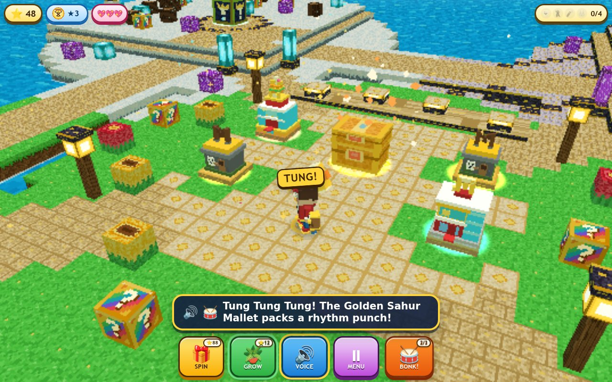

# JJ & Mikey vs Tung Tung Sahur: McDonald's Burger Battle 3D!

A joyful, kid-friendly 3D Three.js (r170) WebGL burger-island adventure built for a **5-year-old child** on iPad or desktop, featuring **100% English UI** and **68 pre-recorded neural voiceover clips (`edge-tts`)**, inspired by Maizen's YouTube video [POOR vs RICH McDonalds Battle in Minecraft](https://www.youtube.com/watch?v=pU0IwO54t74) and **Tung Tung Tung Sahur**!



## Highlights
- **Hero Trio (JJ + Mikey + Tung Tung Tung Sahur)**:
  - Play as **JJ** (Maizen's iconic Pro builder in bright red hoodie over white shirt with white drawstrings, brown hair, cyan-blue eyes, and Golden `"M"` visor) flanked by **Mikey** (bright green turtle with yellow belly shell, red tongue, and mini green noob burger) and **Tung Tung Tung Sahur** (warm teakwood kentungan log buddy with googly eyes, blue sneakers, and mini Sahur drumstick)!
- **3-Tier Poor-vs-Rich McDonald's Burger Shop Stations**:
  - **Tier 1 (`$1` NOOB Shack)**: Mikey's mossy cobblestone burger shack with oak door, yellow wool awning, brown Dirt-Block `"M"` roof sign, and cute white pixel ghost on the wall!
  - **Tier 2 (`$100,000` PRO 2-Story Diamond McDonald's)**: JJ's modern red/white/yellow 2-story restaurant with VIP red carpet, cyan diamond-block side tower, 2nd-floor window dining room, and glowing Golden `"JM"` Arches roof sign!
  - **Tier 3 (`Ultimate Mega Burger Palace + Secret Gold Vault`)**: Stepped golden 2-story McDonald's + cyan diamond towers + glowing underground Gold Vault + Tung Tung Sahur's Golden Kentungan Drive-Thru Archway + rotating Golden Mega Cheeseburger & Sahur Star topper!
- **5 Wacky Burger & Sahur Weapons**:
  1. **Golden Burger Spatula** (`wooden_kentungan_bat`)
  2. **Crispy Fries Fryer Gong** (`bronze_temple_gong`)
  3. **Tung Tung Sahur Mallet** (`golden_sahur_mallet`)
  4. **Fizzy Cola Taiko Blaster** (`neon_thunder_taiko`)
  5. **Rainbow Mega Burger Hammer** (`rainbow_mega_hammer`)
- **4 Giant 3D Boss Visitors & Sesame Burger-Bun Cloud `BOING!` (Zero Game-Over)**:
  - **★1 Cursed Land Ghost** (`tralalero_tralala`): Snow-white pixel ghost with hollow black eyes, open `"O"` mouth, mossy cobblestone block, and red ketchup paintbrush!
  - **★2 Sneaky Burger Robber** (`bombardiro_crocodilo`): Masked robber in black domino mask, burglar stripes, red McDonald's cap, overflowing golden burger-coin loot sack, and silly red plunger pop-blaster!
  - **★3 TNT Rotten Burger Golem** (`brr_brr_patapim`): Giant red-and-white `TNT` demolition block golem crowned with Mikey's smelly green rotten-meat burger and green french fries!
  - **★4 Tung Tung Sahur Burger King** (`golden_sahur_king`): Giant `5.0x` crowned golden Kentungan Titan Chef with a royal golden Burger Crown, Triple Cheeseburger Value Combo tray, and blazing Golden Taiko Drum Mallet!
- **3 Pattable 3D Burger Town Helpers**:
  - **Mini Mikey Turtle Chef**, **Mini Tung Tung Sahur Drummer**, and **Mini JJ Security Guard**!

## Running Locally
Serve the root directory with any static HTTP server:
```bash
python3 -m http.server 8080
```
Then open http://127.0.0.1:8080 in your browser.
